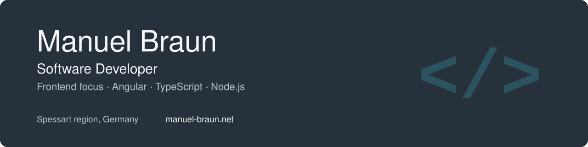

<h1> Hey! Nice to see you.</h1>

  I'm Manuel, a <b>software developer focused on the frontend</b>, based in the Spessart region between Würzburg and Aschaffenburg, Germany 🇩🇪.
  I've been building Angular applications professionally for around two years and have led a client project from initial requirements to final presentation.
  In my own projects I also build the backend with Node.js, Express and PostgreSQL and run my apps myself in Docker containers.

🔭 Currently building <b>Vyte</b>, an event and invitation app: plan the guest list together, send personal invites by link or QR code and let guests upload their photos after the party.

👉 More about me and my projects: <a href="https://manuel-braun.net/"><b>manuel-braun.net</b></a>

 

<h3>Tech stack</h3>

<b>Frontend</b> 
  
  
  
  
  
  
  

<b>Backend & data</b> 
  
  
  
  
  
  

<b>Testing & tools</b> 
  
  
  
  
  
  
  
  
  

<b>AI-assisted development</b> 
  
  

 

<picture>
  <source media="(prefers-color-scheme: dark)" srcset="https://raw.githubusercontent.com/manuelbrauncoder/manuelbrauncoder/output/pacman-contribution-graph-dark.svg">
  <source media="(prefers-color-scheme: light)" srcset="https://raw.githubusercontent.com/manuelbrauncoder/manuelbrauncoder/output/pacman-contribution-graph.svg">
  
</picture>

 

<h3>Find me on</h3>

  
  
  

